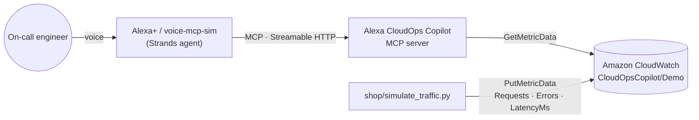

# Alexa CloudOps Copilot

**Ask your cloud, don't dig for it.** An MCP server that gives Alexa+ real cloud-operations tools,
so an on-call engineer can ask *"Why is checkout degraded?"* and get one spoken sentence
backed by live Amazon CloudWatch metrics. No dashboards required.

Built for the Amazon Developer Hackathon (Alexa+ track) with the
[Model Context Protocol](https://modelcontextprotocol.io), [Strands Agents](https://strandsagents.com)
and [Amazon CloudWatch](https://aws.amazon.com/cloudwatch/).

## What it does

| You say | Tool | What happens |
|---|---|---|
| "Why is checkout degraded?" | `diagnose_service` | Reads the last 10 minutes of CloudWatch metrics, compares them to the previous hour and to a 5% error SLO, and links the problem to the latest deployment |
| "Did any deployment fail today?" | `list_failed_deployments` | Lists failed releases in the last N hours |
| "Any critical vulnerabilities?" | `check_critical_cves` | Lists CVEs with CVSS ≥ 9 and the affected service |
| "Open an incident ticket for it." | `create_incident_ticket` | **Write action with two-step voice confirmation** (below) |

Every tool returns a short `speech` sentence written to be read aloud, plus structured
`details`. Tools carry MCP annotations (`readOnlyHint` / `destructiveHint`), so the
client knows which ones change something.

## Safe write actions: nothing happens without a spoken "yes"

A voice assistant can mishear, and a model can be too eager. So creating a ticket takes two calls:

1. **Call without a code:** nothing is created. The server returns a preview ("I'm about to
   create a severity 2 bug titled… Should I go ahead?") and a one-time `confirmation_code`.
2. **Call again with the code:** the server checks it before acting. The code:
   - is bound to a SHA-256 fingerprint of the exact title, description and severity, so an
     edited ticket is rejected;
   - expires after 5 minutes;
   - is single-use, so replaying it does nothing;
   - is never accepted if the model invents it.

The assistant's prompt only allows the second call when the user's latest message clearly says yes.

## Architecture



- **`server.py`**: the MCP server (MCP Python SDK 2.1, Streamable HTTP, stateless).
- **`shop/simulate_traffic.py`**: a fake shop that sends real metrics to CloudWatch every
  10 seconds; `--chaos` makes `checkout-api` start failing.
- **`alexa_sim/`**: a simulated Alexa in the terminal, built with Strands Agents.
  `prompt.txt` holds the voice rules shared with the web version.
- **[voice-mcp-sim](https://github.com/K4lig/voice-mcp-simulated)**: the open-source companion, a
  browser voice assistant (speech in, Amazon Polly voice out, live tool-call panel) for
  testing this or any MCP server.

## Quickstart

```bash
git clone https://github.com/K4lig/Alexa-CloudOps-copilot && cd Alexa-CloudOps-copilot
python -m venv .venv && source .venv/bin/activate && pip install -r requirements.txt
pytest                                   # 13 tests, AWS mocked with moto
python server.py                         # MCP server on http://127.0.0.1:8000/mcp
```

It starts on built-in demo data. To diagnose from **real CloudWatch metrics**, with AWS
credentials configured (`aws configure`):

```bash
python shop/simulate_traffic.py --chaos          # terminal 1: the failing shop
DATA_SOURCE=cloudwatch python server.py          # terminal 2: the MCP server
```

### Talk to it

**Terminal Alexa**, with a free [Groq](https://console.groq.com) key:

```bash
export GROQ_API_KEY="..."                       # keep it in .env, never commit it
python alexa_sim/agent.py
```

**Voice, in the browser**, with [voice-mcp-sim](https://github.com/K4lig/voice-mcp-simulated):

```bash
MCP_URL=http://127.0.0.1:8000/mcp MODEL_PROVIDER=groq \
SYSTEM_PROMPT_FILE=/path/to/Alexa-CloudOps-copilot/alexa_sim/prompt.txt \
python -m voice_mcp_sim                          # open http://127.0.0.1:8080
```

### Model providers

| `MODEL_PROVIDER` | Model (override with) | Notes |
|---|---|---|
| `groq` (default) | `openai/gpt-oss-120b` (`GROQ_MODEL`) | Used for the demo |
| `bedrock` | Claude Haiku 4.5 (`BEDROCK_MODEL_ID`) | The intended production path; see the friction log |
| `ollama` | `qwen3:4b` (`OLLAMA_MODEL`) | Local; needs about 8 GB of RAM |

If a model hangs or errors, `python alexa_sim/check.py` tests each layer separately: tool
listing, a direct tool call, the model alone, and the full agent.

## Configuration

| Variable | Default | Purpose |
|---|---|---|
| `DATA_SOURCE` | `demo` | `cloudwatch` reads live metrics from namespace `CloudOpsCopilot/Demo` |
| `AWS_REGION` | `us-east-1` | Region for CloudWatch and Bedrock |
| `MCP_URL` | `http://127.0.0.1:8000/mcp` | Where the agents find the server |

## Why simulated Alexa?

A real Alexa+ integration with a custom MCP server wasn't available to this project within
the hackathon window (details in [FRICTION_LOG.md](FRICTION_LOG.md)). The server already
speaks standard MCP over Streamable HTTP, so it is ready for any MCP client. The simulator
reproduces what matters for voice: tool choice from natural speech, answers written for the
ear, and confirmation before writes.

## Friction log

Everything that slowed this build down, with workarounds and suggestions:
[FRICTION_LOG.md](FRICTION_LOG.md).

## License

MIT
